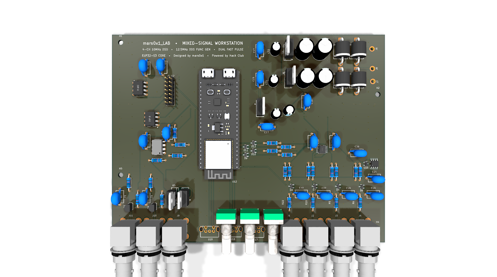

# mars0x1_LAB — Mixed-Signal Electronics Workstation

[](https://hackclub.com)
[](https://kicad.org)
[](file:///assets/pcb_front.svg)
[](LICENSE)

An all-in-one, 4-layer mixed-signal laboratory instrument designed around the **ESP32-S3** microcontroller. `mars0x1_LAB` integrates a **4-channel analog oscilloscope front-end**, an **AD9833 12.5 MHz Direct Digital Synthesis (DDS) function generator**, a **dual high-speed pulse generator**, **3× rotary encoder physical user controls**, and an ultra-low-noise **100% linear split power supply**.

---



---

## ⚡ Technical Specifications

| Subsystem | Specification | Value / Details |
| :--- | :--- | :--- |
| **Physical Dimensions** | Board Size | $175.59\,\text{mm} \times 134.00\,\text{mm}$ ($6.91^{\prime\prime} \times 5.28^{\prime\prime}$) |
| | Layer Stackup | 4 Copper Layers (`F.Cu`, `In1.Cu`, `In2.Cu`, `B.Cu`) |
| | Grounding & Thermal | 4-layer solid DGND planes with **220 DGND ground stitching vias** |
| | Fabrication Rules | Min $0.25\,\text{mm}$ trace, $0.20\,\text{mm}$ clearance, $0.30\,\text{mm}$ via drill (JLCPCB-ready) |
| **Core Controller** | Microcontroller | **ESP32-S3-DEVKITC-1-N8R2** |
| | Processor | Xtensa® 32-bit LX7 dual-core up to $240\,\text{MHz}$ |
| | Memory & Wireless | 8 MB Octal Flash, 2 MB PSRAM, Wi-Fi 4 (802.11 b/g/n), Bluetooth® 5 (LE) |
| | Host Interface | Dual USB-C: Native USB-OTG high-speed telemetry + CP2102/CH343 UART programming |
| **4-Channel Oscilloscope** | Channels | 4 Independent BNC Inputs (`CH 1`, `CH 2`, `CH 3`, `CH 4`) |
| | Analog Buffer | `U6` (`OPA4192IPWR`) — Precision Rail-to-Rail I/O, $10\,\text{MHz}$ GBW, $20\,\text{V}/\mu\text{s}$ slew rate, $5.5\,\text{nV}/\sqrt{\text{Hz}}$ ultra-low noise |
| | Precision Reference | `U10` (`REF3025AIDBZT`) — $2.50\,\text{V}$ voltage reference ($50\,\text{ppm}/^\circ\text{C}$) |
| | Input Protection | 4× $1\,\text{k}\Omega$ series current limiters (`R32`–`R35`) + 4× `BAT54S` Schottky clamping diodes (`D9`–`D12`) to $3.3\,\text{V}$ & DGND |
| **DDS Function Generator** | Core IC | Analog Devices AD9833 (28-bit frequency accumulator, $0.1\,\text{Hz}$ to $12.5\,\text{MHz}$) |
| | Module Sockets | Dual parallel female headers (`J5` Standard & `J12` Swapped CS/SDATA pinout) |
| | Waveforms | Sine, Triangle, Square (programmable via SPI) |
| | Output Driver | `U20` (`MCP4131`) digital potentiometer + `U9` (`TL071`) buffer + `TIP31C`/`TIP32C` complementary push-pull driver capable of driving $50\,\Omega$ loads |
| **Dual Pulse Generator** | Outputs | `PULSE 1` (`J11`) and `PULSE 2` (`J10`) via $75\,\Omega$ BNC connectors |
| | Drivers | Discrete NPN emitter-follower buffers (`Q1`, `Q4` `2N3904`) powered by $+5\,\text{V}$ |
| | Duty & Width | ESP32 hardware timers (MCPWM/LEDC) on clean GPIOs 47 & 21 |
| | Amplitude Control | `U8` (`MCP4131`) digital potentiometer + $1\,\text{k}\Omega$ emitter pull-downs (`R36`, `R37`) |
| **Front Panel Controls** | Rotary Encoders | 3× ALPS EC11 Encoders with Push Switches (`U17` TIME, `U18` VOLT, `U19` MENU) |
| **Power Supply (100% Linear)** | AC Input | 3-terminal pads (`J6`, `J7`, `J8`) for external center-tapped $12\text{V}-0-12\text{V}$ AC transformer secondary |
| | Rectification & Bulk | 6A full-wave bridge rectifier (`D1`–`D4` `6A10`) + $4000\,\mu\text{F}$ reservoir (`C1`–`C4`) |
| | Voltage Regulators | $+12\,\text{V}$ (`LM7812`), $-12\,\text{V}$ (`LM7912`), $+5\,\text{V}$ (`LM7805`) |
| | Noise & Ripple | Zero switching hash, pure analog linear regulation |

---

## 🎛️ Front Panel & Connector Mapping

All front-panel connectors along the bottom edge ($Y \approx 185.5\,\text{mm}$) are clearly ordered and labeled on the silkscreen from left to right:

```
+----------------------------------------------------------------------------------------------------+
|  [J11]       [J10]       [J9]          [U19]         [U18]         [U17]     [J1]   [J2]   [J3]   [J4]   |
| PULSE 1     PULSE 2    DDS OUT     ENC 3 (MENU)  ENC 2 (VOLT)  ENC 1 (TIME)  CH 1   CH 2   CH 3   CH 4   |
+----------------------------------------------------------------------------------------------------+
```

---

## 🔌 Power & Safety Instructions

> [!IMPORTANT]
> **External Low-Voltage AC Transformer Only — DO NOT CONNECT MAINS (120V / 240V)!**
> * Terminals `J6`, `J7`, and `J8` connect exclusively to the **low-voltage secondary side** of an external center-tapped transformer ($12\text{V}-0-12\text{V}$ AC, 20VA to 50VA).
> * `J8` = `~12V AC` (Secondary Leg 1)
> * `J7` = `0V CT` (Secondary Center Tap / Earth DGND)
> * `J6` = `~12V AC` (Secondary Leg 2)
> * The ESP32 DevKit is powered via USB Type-C from your host PC.

> [!WARNING]
> **TO-220 Tab Isolation:**
> * `LM7812` & `LM7805` tabs are connected to **DGND**.
> * `LM7912` tab is connected to **$-18\,\text{V}$ DC raw input**, NOT ground!
> * `TIP31C` & `TIP32C` tabs are connected to $+12\text{V}$ and $-12\text{V}$ collectors.
> * Always use **individual clip-on heatsinks** or insulating Sil-Pads and shoulder washers if mounting to a shared metal bracket.

---

## 📁 Repository Structure

```text
mars0x1_LAB/
├── assets/
│   ├── pcb_3d_render.png          # High-resolution 3D raytraced preview
│   ├── pcb_front.svg              # Top copper and silkscreen vector
│   ├── pcb_back.svg               # Bottom copper and silkscreen vector
│   ├── schematic_diagram.svg      # A3 schematic vector export
│   └── schematic.pdf              # Full production schematic PDF
├── gerbers/                       # Raw RS-274X Gerber & Excellon drill files
├── gerbers.zip                    # Ready-to-upload archive for JLCPCB
├── mars0x1_LAB.kicad_pro          # KiCad 9 Project file
├── mars0x1_LAB.kicad_sch          # KiCad 9 Schematic
├── mars0x1_LAB.kicad_pcb          # KiCad 9 PCB Layout
├── .gitignore
├── LICENSE                        # MIT License
└── README.md
```

---

## 🛠️ How to Order on JLCPCB

1. Download [`gerbers.zip`](gerbers.zip).
2. Go to [JLCPCB.com](https://jlcpcb.com) and click **Order Now**.
3. Drag and drop `gerbers.zip`.
4. Choose the following standard parameters:
   * **Layers:** 4
   * **Dimensions:** $175.59 \times 134.00\,\text{mm}$ (auto-detected)
   * **PCB Thickness:** 1.6 mm
   * **PCB Color:** Green / Blue / Black / Purple (user choice)
   * **Surface Finish:** HASL with lead (or ENIG for gold-plated pads)
   * **Copper Weight:** 1 oz outer / 0.5 oz inner
5. Submit order (Total cost for 5 boards fits well within the **$100 Hack Club OnBoard grant**).

---

## 📜 Credits & License

* **Designed by:** `mars0x1`
* **Sponsorship:** Built with support from [Hack Club](https://hackclub.com).
* **License:** [MIT License](LICENSE).
